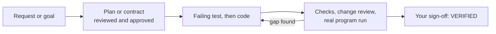

<p align="center">
  <picture>
    <source media="(prefers-color-scheme: dark)" srcset="assets/buracle-dark.svg">
    
  </picture>
</p>

<p align="center"><b>English</b> · <a href="README.tr.md">Türkçe</a></p>

<div align="center">

### One engineering setup for Claude Code, Codex CLI, OpenCode and Oh My Pi

Shared memory, workflows that finish with proof, and the same tools and guards in every coding agent you use.

[](https://github.com/burakarslan0110/buracle/actions/workflows/ci.yml)
[](https://github.com/burakarslan0110/buracle/releases/latest)
[](LICENSE)
[](https://bun.sh)

[Install](#install) · [Why Buracle](#why-buracle) · [Workflows](#workflows) · [The brain](#the-brain) · [Settings](#settings) · [Harnesses](#what-each-harness-gets)

macOS · Linux · Windows, on x64 and arm64

</div>

## Why Buracle

Claude Code, Codex CLI, OpenCode and Oh My Pi each have their own config format, their own hooks, their own memory and their own idea of a skill. If you use more than one, you set each of them up by hand, and none of them knows what you decided in another.

Buracle sets all four up from one source and keeps them in step:

- One memory for every agent. Each project has a brain, and you have one that follows you across projects. A decision recorded in Claude Code is there when you open Codex the next morning.
- Workflows with a contract. `/plan-build`, `/goal-build`, `/bugfix` and `/requirements` write durable files, wait for your approval where it matters, write the failing test first, run independent reviews and keep going until the result is verified.
- Guards that make no-prompt mode safe. Hooks block catastrophic commands, ask in the harness's own dialog before ones that are hard to undo, protect secrets and mask them in tool output.
- The right tool for each question. Ten MCP servers and six language servers are installed and wired into the harnesses, and routing hooks send each question to the server built for it.
- One source of truth. Skills, rules, review agents, hooks and MCP config live in `canonical/`. `buracle install` writes each harness's own format, with backups, a journal and rollback.
- A control panel. The Buracle Brain web UI shows the memory, a review page for plans and diffs, sessions and usage across all four harnesses, and the settings.

## Install

### Before you start

Install at least one harness: [Claude Code](https://code.claude.com/docs/en/quickstart), [Codex CLI](https://developers.openai.com/codex/cli), [OpenCode](https://opencode.ai) or [Oh My Pi](https://www.npmjs.com/package/@oh-my-pi/pi-coding-agent). Buracle sets up every harness it finds and skips the rest. The script installs Bun when it is missing, and Git on Windows. On Linux it never runs sudo or a package manager: it prints the command that installs what is missing (Git, curl, unzip, Node.js, uv, ripgrep, jq) on your distribution.

### Install

macOS and Linux:

```sh
curl -fsSL https://github.com/burakarslan0110/buracle/releases/latest/download/install.sh | bash
```

Windows (PowerShell):

```powershell
irm https://github.com/burakarslan0110/buracle/releases/latest/download/install.ps1 | iex
```

Both scripts come from the latest GitHub release. On Windows everything installs for your user, without administrator rights: tools through `winget --scope user` (or scoop), and directory links as junctions. The one exception is the Visual C++ runtime, which codegraph and ast-grep need and most Windows machines already have; when it is missing, the script installs it only from an administrator terminal and otherwise prints the command. The script clones Buracle's `main` branch into `~/buracle`, installs its dependencies, then runs `buracle install` and `buracle doctor`. `main` holds the released files: CI writes it, without the test suite, only when it publishes a release, and `buracle update` follows it. Running the script again updates the checkout and repairs the setup. Both scripts are short enough to read first: [`install.sh`](scripts/install.sh), [`install.ps1`](scripts/install.ps1).

After the install:

1. Run `/reload-plugins` in any Claude Code session that is already open. Sign in to the other harnesses once: `codex login`, `opencode auth login`, `omp login`.
2. Run `buracle project init` in each project. It maps the project to its brain and links its skills for every harness.
3. Run `buracle update` whenever you want the newest Buracle, harnesses and tools.

<details>
<summary><b>What <code>buracle install</code> does</b></summary>

1. Build. It generates the harness files from `canonical/` and `src/`. A failed build installs nothing.
2. Runtime. It copies the checkout into `~/.buracle/runtime/<id>` and tests the copy: `--version` must run, and the Claude Code and Codex hooks must deny `rm -rf ~` and allow `ls`. Only then does the `buracle` command switch to it. The previous runtime is kept for rollback.
3. Toolchain. It installs missing system tools through Homebrew (macOS, and Linux when Homebrew is installed), winget or scoop (Windows); on Linux without Homebrew it only reports each missing tool with the command for your distribution. It installs every MCP server and language server into `~/.buracle/toolchain`. Everything comes in its newest release, CortexDB included (a new CortexDB is used only after it passed the memory's check, with the brains backed up first). `update.minReleaseAgeDays` (0 by default) can make Buracle wait some days after a release.
4. Core. The `~/.buracle/bin/buracle` command, its `~/.local/bin/buracle` link, `~/.buracle/config.yaml` and the shared skills in `~/.agents/skills`.
5. Harnesses. Each harness gets its own transaction: backup, atomic writes, journal, commands, verification, ownership ledger and commit. If one harness fails, only that harness rolls back.
6. Memory. It creates `~/.buracle/brain`.

Values you changed by hand are kept and reported. In a terminal it applies at once and shows each step. Scripts and agents pass `--yes`.

</details>

<details>
<summary><b>Update, roll back, uninstall</b></summary>

- `buracle update` checks Buracle, skills, MCP servers, Claude Code plugins, the harnesses, the tools and the price list, and updates each part from its own source. A harness is updated with the installer that installed it (Homebrew, npm, bun or its own updater) and its version is read again afterwards. `--check` only checks, and names narrow it down: `buracle update codex mcp`. A toolchain upgrade has to prove itself: an MCP server must start and answer, and a tool must run its version check. One that does not goes back to the version the toolchain kept.
- `buracle rollback` undoes the newest install from its backups. `buracle rollback toolchain` puts back the previous toolchain versions.
- `buracle uninstall` removes only what the ownership ledger proves Buracle wrote. Values you changed stay, and the memory in `~/.buracle/brain` is never touched.

</details>

## First steps

Open your harness in a project and work as usual. Buracle loads its rules, memory and tools around the session. Three ways of working sit side by side, under the same guards and the same memory:

| Way of working | What you get |
|---|---|
| A direct request | The agent understands, changes, verifies and reports, following Buracle's rules and memory |
| The harness's own plan mode | The plan you approve is saved to `docs/plans/` and survives the session (OpenCode saves a draft) |
| A Buracle workflow | A durable plan, contract or PRD, approval gates, test-first work, independent reviews and verification |

Run `/project-rules` once per repository: it reads the code, runs the commands it documents and writes an `AGENTS.md` that every harness follows. In Codex, type `$` where this page says `/`.

## Workflows

| Workflow | Use it when | What you get |
|---|---|---|
| `/plan-build` | You want a reviewed plan approved before any code | A plan in `docs/plans/`, a plan review, a failing test before each change, a change review, a run of the real program on every changed surface, end-to-end scenarios and your sign-off on the result |
| `/goal-build` | The end state is clear and the path is found by building | A locked contract in `docs/builds/` with pass/fail criteria, build and judge rounds where missing evidence counts as a fail, and a verification phase at the end |
| `/bugfix` | One behavior is broken and you want proof it is fixed | The failure reproduced first, the root cause named as `file:line`, a failing test before the fix, a fix where the fault starts, a change review and an end-to-end check |
| `/requirements` | The problem, audience or scope is still unclear | A few rounds of questions, research, and an approved PRD in `docs/prd/` that hands off to the right build workflow |



What holds these workflows together:

- A stop guard keeps the turn open until the plan is verified. Only a pause ends it, and you can pause at any time by saying stop, wait or hold on, in English or Turkish.
- `--worktree`, `--new-branch` or `--current-branch` after the request decide where the work happens. A worktree run is squash-merged back when it is done.
- Before any approval, the agent reads the notes you pinned on the review page and marks each one applied.
- `buracle plan audit` compares the diff with the files each task named and flags changes no task planned.
- With `plan.reviews.companion`, the same review also runs on another installed harness as a read-only second opinion.
- Independent plans can run in parallel as lanes, each in its own worktree, and merge in dependency order.

You decide how these workflows run in the web UI's [settings](#settings) or with `buracle config set plan.<key> <value>`.

### More workflows

| Command | What it does |
|---|---|
| `/research <question>` | Cited research across the web, library docs, public code and memory. Every source is read before it is cited |
| `/inspect <question>` | Traces one question through the code that actually runs, cites every hop as `path:line`, tries to disprove its own answer and states its confidence. Changes nothing |
| `/dead-code` | Reports unused code. A candidate needs two independent signals, and the result is a staged removal plan. Changes nothing |
| `/security-audit` | Cloudflare's security skill: focused guidance, or a six-phase audit with findings and a report |
| `/project-rules` | Writes and checks `AGENTS.md`, nested `AGENTS.md` files and path rules from commands it ran |
| `/new-skill` | Captures a repeatable procedure as a skill with evals, and lints it |
| `/find-skill` | Searches your skills and the skills.sh registry with license, freshness and risk ratings, audits the pick and installs it for every harness |
| `/ab-test` | Runs paired before/after trials in throwaway config folders to measure whether a skill or rule change changes what the agent does |

| Utility | What it does |
|---|---|
| `/brain` | Opens the Buracle Brain web UI. `/brain review` opens the review page |
| `/remember <text>` | Saves a note to the memory |
| `/aside <question>` | Answers a side question without derailing the task |
| `/buracle-status` | Shows the plan, the workflow and the memory at a glance |

### Rules

Four rules load in every session: core (autonomy, evidence before "done", testing, change discipline, debugging), tooling (which tool answers which question), memory and plain language. Path rules load when the agent touches matching files: TypeScript, Python, Go, .NET, Blazor, frontend, browser automation, backend and mobile.

## The brain


Buracle's memory lives in one [CortexDB](https://github.com/liliang-cn/cortexdb) file, `~/.buracle/brain/brain.db`, with a bucket for each project and one for you. Every harness reaches it through the `buracle-memory` MCP server, whose six tools (search, get, write, update, status, context) each have a CLI twin under `buracle mem`. A brain sorts its memories into seven regions:

| Region | What it holds |
|---|---|
| Plans & decisions | Decisions with their reasons and the alternatives that were rejected |
| Knowledge & ideas | Project knowledge, and the core pages (brief, architecture, conventions, commands, glossary, progress) of projects set up by an older Buracle |
| Discoveries & references | Links and references worth keeping |
| You & preferences | Your preferences and the conventions of the project |
| Skills & procedures | Procedures that took real effort to work out |
| Warnings & gotchas | Non-obvious failures and their root causes |
| Memories & events | Sessions, handoffs and captures |

Upgrading from 0.5: [MIGRATION.md](MIGRATION.md) (what the migration does, how to check it and go back). Why the memory looks like this, with measurements: [ARCHITECTURE.md](ARCHITECTURE.md). What each harness and operating system supports, and what was verified: [COMPATIBILITY.md](COMPATIBILITY.md).

### What it does, and when

- When a session starts, the agent gets your preferences, the project's key memories and, if work was cut off, a handoff saying where it stopped. Reading is all that happens at that moment.
- While you work, the preferences you state ("always", "never", "from now on") are noted in the session's spool, with a short redacted quote.
- Before the context is compacted, the plan, task and todo state go into a handoff memory, and they come back right after.
- When a session ends, one `buracle mem finalize` run writes the session memory, files your stated preferences as explicit memories without any model, and asks the model of the harness you used for the decisions, gotchas and procedures worth keeping. Its answer is checked as a whole before anything is written. Confident findings become memories marked as inferred, with the model's confidence, and the rest wait as captures to be filed. A finding that resembles a memory of yours (explicit, pinned or verified) never changes it: it is stored beside it, marked as contradicting. The same run takes up to three older sessions whose capture is still owed.
- `buracle mem capture` does the same on demand, and `buracle mem doctor` lists what is still owed.

Nothing else runs in the background: no timers, no start-up jobs, no repair or cleanup passes. Sessions and handoffs expire by themselves, because CortexDB drops them after 45 and 14 days. `buracle mem backup` copies the whole brain file when you ask, and a session end takes one copy whenever the newest is more than a day old (the newest 10 are kept).

Model calls go through the CLI of a harness you already use, so no API key is needed. The session's own harness goes first, and a harness whose 5-hour usage is above 75% or whose weekly usage is above 85% is skipped. Search is by words, with the English and Turkish word forms.

Secrets are masked before anything is written, `<private>…</private>` blocks are never stored, and folders listed in `memory.exclude` are never recorded. A retired memory stays hidden from search until you delete it, so you can restore it. `buracle mem export` and `buracle mem import` move memories as JSON lines, and `buracle mem restore` brings a backup back.

### Buracle Brain, the web UI


`/brain` or `buracle mem ui --open` opens it at `http://localhost:41777`. It starts only when you run that command, and it stops by itself after 30 minutes without a request (`BURACLE_UI_IDLE_MS`, in milliseconds, changes that). Ctrl-C and `buracle mem ui --stop` stop it too.

- Brain view. The regions drawn as a brain, where writes and searches light up as they happen. `/` searches, `1` to `7` open a region and `G` shows the network of memories, tags, files and concepts.
- Memory detail. The body, tags, sources and history, where the memory came from (your words or inferred, with its confidence) and the memories it links to, with edit, retire, restore and delete. An edit is stored as your own words.
- Review page. Your plans, build contracts and PRDs, and the agent's diff. Select text or click a line number to pin a note for the agent.
- Health (`H`). What is wrong in plain words, the store and its version, the brain file with its size and buckets, the move from Buracle 0.5, the inbox of captures, the last capture and the backups, with a Back up button.
- Sessions and usage (`W`). Sessions across all four harnesses for the last 30 days (counts only, never what you typed), commits landed, cost and tokens per day and model, and the installed skills, agents and rules.
- Notifications (`N`) and a dark and a light theme (`T`).


The page writes only through token-checked requests to its own local server.

#### Settings


Press `S` to open the settings. They come in two groups.

Workflow switches decide how plan-build, goal-build and bugfix run on every harness. You change them here or with `buracle config set plan.<key> <value>`. An agent cannot use this page, and it cannot change the approval, review and verification switches at all. A change is written to `~/.buracle/config.yaml` at once and applies the next time a workflow reads it, while a running goal-build keeps the values it locked with its contract. Each switch shows its key, a short explanation with more under "How it works", and a note when it differs from the shipped default.

| Switch | Key | Default |
|---|---|---|
| Pause a running plan when you send a new message | `plan.autoPause` | off |
| Ask for your approval of a plan before building | `plan.planApproval` | on |
| Ask for your approval of the verified result | `plan.resultApproval` | on |
| Build on a branch of its own, in a worktree | `plan.branchIsolation` | on |
| Ask clarifying questions while planning | `plan.questions` | on |
| Independent review of the plan | `plan.reviews.plan` | on |
| Independent review of the changes | `plan.reviews.changes` | on |
| Independent review of a goal-build contract | `plan.reviews.goal` | on |
| Second opinion from another harness | `plan.reviews.companion` | `off`, or `auto`, `claude`, `codex`, `opencode`, `omp` |
| Verify a goal-build after its criteria pass | `plan.goalVerification` | on |
| Pause after approval to switch the model | `plan.modelSwitch` | `off`, or `manual` |
| Plan in the harness's own plan mode | `plan.nativePlanMode` | `off`, or `on` |

Model for capture shows the rule the memory follows when it borrows a harness for the end-of-session distillation: a harness runs the call only while its 5-hour window is under 75% and its weekly window under 85%. Below the rule you see which harness would run the next call, how much of each window it has used, and when a harness that is held back frees up. Nothing in this group needs a setting.

The last line names the port the web UI listens on and the config file it writes to.

## What each harness gets

All four get the same 27 hooks, skills, review agents, rules, memory, guards and status line data. What differs is how Buracle plugs in and what each host can show.

| | Claude Code | Codex CLI | OpenCode | Oh My Pi |
|---|---|---|---|---|
| Plugs in as | A plugin with a mod | `hooks.json`, `config.toml` keys, an `AGENTS.md` block and exec-policy rules | A server plugin and a TUI plugin | An omp plugin with an extension |
| Workflows | `/plan-build` | `$plan-build` | `/plan-build` | `/plan-build` |
| Utility commands | `/brain`, `/remember`, `/aside`, `/buracle-status` | CLI twins, with `/aside` mapped to Codex's `/side` | All four in the TUI, with `/aside` mapped to `/btw` | All four |
| Consent | A dialog inside Claude Code | Codex's own approval prompt | A TUI dialog, or the question tool on web and desktop | omp's select dialog |
| Workflow progress | A band above the prompt, memory and plan panes | The status bar in tmux and `buracle plan status` | A band above the composer and a dialog | A widget above the editor and a pane below it |
| Status line | Buracle's own status line | Codex's native items and a tmux bar | The prompt footer | omp's native preset with Buracle entries |
| Plan mode | Saved to `docs/plans/` | Saved when you choose to implement the plan | Saved as a draft | Saved on approval |
| Language servers | Claude Code's LSP | Buracle's `lsp` MCP server | Buracle's `lsp` MCP server | omp's own LSP |
| Browser | chrome-devtools | chrome-devtools | chrome-devtools | omp's built-in browser |

Buracle switches off the built-in memory of Claude Code, Codex and Oh My Pi, so the brain is the one memory all four share. Review agents always run read-only. Where a host lacks a hook Buracle needs, [`src/adapters/shared/host-limits.ts`](src/adapters/shared/host-limits.ts) records the gap and the fallback, and `buracle doctor` tells you when a newer harness version may close it.

| Harness | Tested with |
|---|---|
| Claude Code | 2.1.302 |
| Codex CLI | 0.162.1 |
| OpenCode | 2.0.30 |
| Oh My Pi | 18.10.1 |

## Guards

Buracle runs the harnesses without approval prompts and lets its hooks do the guarding:

- Catastrophic commands are denied: `rm -rf` of `/` or `~`, a force push to main, `curl | sh`, `mkfs`, `dd` to a device and similar.
- Writes to secrets (`.env` files, keys, credentials), `~/.ssh`, `~/.aws` and Buracle's own setup are denied.
- Commands that are hard to undo (force push, `reset --hard`, rebase, amend, branch delete, `git clean`) wait in the harness's own dialog until you allow them once, allow them for the session, or refuse. The model cannot replay an earlier answer.
- Keys, tokens and passwords are masked in what tools return before the model reads it.
- In Claude Code and Codex, a hook that cannot load or decide denies the command and names `buracle doctor`.

`guards.bash.extraDeny` and `guards.write.protect` in `~/.buracle/config.yaml` add your own patterns.

## Tools

| MCP server | Used for |
|---|---|
| `buracle-memory` | The brain |
| [`context7`](https://github.com/upstash/context7) | Library and framework docs |
| [`codegraph`](https://github.com/colbymchenry/codegraph) | Symbols, callers and the impact of a change |
| [`semble`](https://github.com/MinishLab/semble) | Semantic code search |
| [`web-search`](https://www.npmjs.com/package/open-websearch) | Web search without an API key |
| [`web-fetch`](https://www.npmjs.com/package/fetcher-mcp) | Reads web pages in a headless browser |
| [`grep`](https://grep.app) | Code examples from public GitHub repositories |
| [`chrome-devtools`](https://github.com/ChromeDevTools/chrome-devtools-mcp) | Drives a Chrome browser |
| `lsp` | Language-server diagnostics and navigation for Codex and OpenCode |

The toolchain also brings `rg`, `ast-grep`, `jq`, `gh`, `tmux`, `ruff`, `shellcheck` and `golangci-lint`, and six language servers: pyright, typescript-language-server, gopls, rust-analyzer, csharp-ls and jdtls. A session start runs no indexing: Buracle builds a project's first codegraph index when the codegraph server starts there, after that codegraph and semble keep their own indexes fresh, and in a folder that holds several projects the agent builds the index of the project it needs with `buracle index ensure --cwd <project>`. After every edit, the matching checker runs and its findings go back to the agent.

In Claude Code, the status line looks like this:

```
Opus 5.5 [xhigh] [1M] | ███░░░░░ 37% | 5h: 42% ↓ 1h20m | 7d: 18% ↓ 1d6h | ~/project | ⎇ main
plan-build ● Implement 3/7 | Rate limit the public API
Buracle 0.5.0 · CC 2.1.296 (Max) · Memory: localhost:41777 · brain 142 ✓ · idx ready
```

## The buracle command

Run `buracle` in a terminal and it opens a menu with the logo, one line that says whether all is well, and six choices: install or repair, update, health check, memory, a detailed view of every part with its version and pending update, and quit. Arrow keys or j/k move, Enter runs the choice, and each choice has its own key.

While the menu is open, Buracle re-checks what was last verified more than six hours ago: the MCP servers answer a live handshake, the tools report their version and the update check runs again. A row says `checking…` until its result is in. A check never downloads anything, so a server whose package is not in the toolchain waits for `buracle install`. In the detailed view, `n` jumps to the next row that needs a look and `r` rechecks everything now.

| Command | What it does |
|---|---|
| `buracle install [<harness>…]` | First setup and repair, for every harness it finds or the ones you name |
| `buracle update [--check]` | Updates each part from its own source |
| `buracle doctor [<topic>]` | Checks hooks, MCP servers, memory and code indexes. A topic such as `mcp` or `memory` checks one part |
| `buracle config` | Reads or changes the configuration with `get`, `set` and `unset` |
| `buracle rollback` | Undoes the newest install |
| `buracle uninstall` | Removes everything Buracle installed and leaves the memory alone |

Your agents use more commands, such as `plan`, `worktree`, `mem`, `skills` and `project`. `buracle help --all` lists them and `buracle help <command>` explains one.

## Development

```sh
bun install
bunx tsc --noEmit -p .
T=$(mktemp -d) && HOME=$T BURACLE_HOME=$T/.buracle bun src/cli/main.ts build --check
bun test
```

CI runs these checks on macOS (arm64), Linux (x64) and Windows (x64). Work lands on `dev`, so clone that branch to develop. When every check passes there and the released files changed, CI picks the next version by itself (0.5.0, 0.5.1, 0.5.2 and so on), writes that commit to `main` at that version and without the test suite (`tests/` and `bunfig.toml`), then publishes `v<version>` from it on GitHub with both install scripts attached. Nothing runs on `main`. To start a new line, raise the major or minor version in `package.json`.

Read [`AGENTS.md`](AGENTS.md), [`CONTRIBUTING.md`](CONTRIBUTING.md) and [`SECURITY.md`](SECURITY.md) before you send a change. Found a bug or missing a feature? [Open an issue](https://github.com/burakarslan0110/buracle/issues).

## License

[MIT](LICENSE). The `security-audit` skill is Cloudflare's [security-audit skill](https://github.com/cloudflare/security-audit-skill), also MIT, with its license in [`canonical/skills/security-audit/assets/`](canonical/skills/security-audit/assets/).
