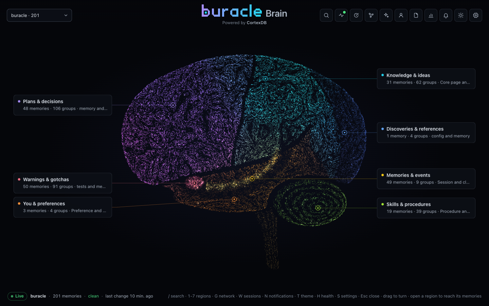

<p align="center">
  <picture>
    <source media="(prefers-color-scheme: dark)" srcset="assets/buracle-dark.svg">
    
  </picture>
</p>

<p align="center"><b>English</b> · <a href="README.tr.md">Türkçe</a></p>

<div align="center">

### One engineering setup, one memory, every coding agent

Skills, rules, MCP servers, hooks and guards managed from one source, one memory every agent shares, and workflows that finish with proof.

macOS · Linux, on x64 and arm64

```sh
curl -fsSL https://github.com/burakarslan0110/buracle/releases/latest/download/install.sh | bash
```

[](https://github.com/burakarslan0110/buracle/actions/workflows/ci.yml)
[](https://github.com/burakarslan0110/buracle/releases/latest)
[](LICENSE)
[](https://bun.sh)

[Why Buracle](#why-buracle) · [Install](#install) · [Workflows](#workflows) · [Memory](#memory) · [Settings](#settings) · [Harnesses](#what-each-harness-gets)

</div>

## Why Buracle

Buracle sets up the coding agents you use from one source. Claude Code, Codex CLI, OpenCode, Oh My Pi, Qwen Code, Pi and AGY CLI get the same skills, MCP servers, hooks and guards, and they share one memory, so a decision made in one agent is there in the next. Its workflows plan, test and review, and stop only when the result is verified.

- One setup in `canonical/`: `buracle install` writes each harness's own format, with backups, a journal and rollback.
- One memory: a brain per project and one for you.
- Workflows (`/plan-build`, `/goal-build`, `/bugfix`, `/requirements`) with durable files, approval gates, test-first work and independent reviews.
- Guards for no-prompt mode: hooks block catastrophic commands, ask before hard-to-undo ones and mask secrets.
- Nine MCP servers and six language servers, with routing hooks that send each question to the right one.
- The Buracle Console, a local web page for the memory, plan review and workflow settings.

## Install

Buracle runs on macOS and Linux (no Windows or WSL). You need at least one harness: [Claude Code](https://code.claude.com/docs/en/quickstart), [Codex CLI](https://developers.openai.com/codex/cli), [OpenCode](https://opencode.ai), [Oh My Pi](https://www.npmjs.com/package/@oh-my-pi/pi-coding-agent), [Qwen Code](https://github.com/QwenLM/qwen-code), [Pi](https://www.npmjs.com/package/@earendil-works/pi-coding-agent) or [AGY CLI](https://antigravity.google). Buracle sets up every harness it finds.

```sh
curl -fsSL https://github.com/burakarslan0110/buracle/releases/latest/download/install.sh | bash
```

The script installs Bun if needed, clones `main` into `~/buracle` and runs `buracle install`. You provide git and curl (on Linux also unzip, and libatomic1 when Node.js is missing). It never runs sudo or a package manager; on Linux it prints the command for your distribution. Node.js, uv, ripgrep and jq come through Homebrew, or as pinned, checksum-verified downloads under `~/.buracle/toolchain/system`. Read the script first if you like: [`install.sh`](scripts/install.sh).

`buracle install` installs every MCP and language server, writes each harness's config as a transaction (backup, journal, ownership ledger, rollback of that harness alone), creates the brain, puts `~/.local/bin` on your PATH and starts the Buracle Console. Details go to `~/.buracle/logs/install-<date>.log`. Values you changed by hand are kept. Running the script again updates and repairs.

Then:

1. Run `/reload-plugins` in any open Claude Code session. Sign in to the other harnesses once (`codex login`, `opencode auth login`, `omp login`, and the sign-in of Qwen Code, Pi and AGY CLI).
2. Run `buracle project sync` in each project. It checks for an `AGENTS.md`, links `.agents/skills` into `.claude/skills` and sets up the project's brain.
3. Run `buracle update` when you want the newest Buracle, skills and tools. `--check` only checks, and `buracle update mcp codegraph` narrows it down.

`buracle uninstall` removes only what the ownership ledger shows Buracle wrote. Values you changed stay and `~/.buracle/brain` is never touched.

## Workflows

Open your harness in a project and work as usual: a direct request, the harness's own plan mode (the approved plan is saved to `docs/plan-build/`; OpenCode saves a draft) or a Buracle workflow. All three run under the same guards and the same memory. Run `/project-rules` once per repository to write an `AGENTS.md` that every harness follows. In Codex, type `$` where this page says `/`; in Pi, `/skill:` (for example `/skill:plan-build`).

| Workflow | Use it when | What you get |
|---|---|---|
| `/plan-build` | You want a reviewed plan approved before any code | A plan in `docs/plan-build/`, a failing test before each change, reviews, a real-program run and your sign-off |
| `/goal-build` | The end state is clear and the path is found by building | A locked contract in `docs/goal-build/` with pass/fail criteria, judged build rounds, a final verification |
| `/bugfix` | One behavior is broken and you want proof it is fixed | The failure reproduced, the root cause as `file:line`, a failing test, the fix, an end-to-end check |
| `/requirements` | The problem or scope is still unclear | A few rounds of questions and an approved PRD in `docs/requirements/` |

- A stop guard keeps the turn open until the plan is verified. Say stop, wait or hold on to pause it.
- `--worktree`, `--new-branch` or `--current-branch` after the request decide where the work happens; a worktree run is squash-merged back.
- `buracle plan audit` flags changes no task planned.

Also available: `/research` (cited research), `/inspect` (traces a question through the code that runs, changes nothing), `/dead-code` (staged removal plan, changes nothing), `/project-rules`, `/new-skill`, `/find-skill`, `/ab-test` (measures whether a skill or rule change alters agent behavior), `/brain` (opens the Buracle Console), `/remember <text>`, `/aside <question>` and `/buracle-status`.

Four short rules load in every session, under 8 KB together (`buracle rules lint` enforces it). Detail sits in skill references the agent reads when needed. Plans, PRDs and reports follow your language; only the markers Buracle reads stay English.

## Memory



The memory lives in one [CortexDB](https://github.com/liliang-cn/cortexdb) file, `~/.buracle/brain/brain.db`, with a bucket per project and one for you. Every harness reaches it through the `buracle-memory` MCP server, whose six tools each have a CLI twin under `buracle mem`. [ARCHITECTURE.md](ARCHITECTURE.md) covers the design and [COMPATIBILITY.md](COMPATIBILITY.md) what was verified.

- A session start gives the agent your preferences, key project memories and, if work was cut off, a handoff. A preference you state ("always", "never", "from now on") is saved at once. Before compaction, plan and todo state go into a handoff memory.
- When a session ends, one `buracle mem finalize` run writes the session memory and asks the model of the harness you used for the decisions, gotchas and procedures worth keeping. Confident findings are stored as inferred; the rest wait as captures. A finding never changes one of your own memories: it is stored beside it, marked as contradicting. `buracle mem capture` does the same on demand, `buracle mem doctor` lists what is still owed.
- Nothing else runs in the background. Sessions and handoffs expire after 45 and 14 days. `buracle mem backup` and `buracle mem restore` copy the brain file; a session end also takes a copy when the newest is over a day old (the newest 10 are kept).

Model calls use the CLI of a harness you already have, so no API key is needed; one whose 5-hour usage is above 75% or weekly usage above 85% is skipped. Secrets are masked before anything is written, `<private>…</private>` blocks are never stored and folders in `memory.exclude` are never recorded.

### Buracle Console

`/brain` or `buracle mem ui --open` opens the Console at `http://localhost:41777` (`buracle mem ui --port N` for another port). It starts with the install or a session start, stays up while a harness session is open and stops about a minute after the last one (`BURACLE_UI_IDLE_MS` sets the idle stop). `buracle mem ui --stop` stops it; `buracle config set memory.ui.autostart false` starts it only with `buracle mem ui`. It shows the brain (`/` searches, `1` to `7` open a region, `G` the network), each memory with edit, retire, restore and delete, a review page for plans, contracts, PRDs and diffs where you can pin notes for the agent, and a health view (`H`).

#### Settings

Press `S`. The workflow switches decide how plan-build, goal-build and bugfix run on every harness. Change them here or with `buracle config set plan.<key> <value>`. They are written to `~/.buracle/config.yaml` at once; a running goal-build keeps the values it locked. An agent cannot change the approval, review and verification switches.

| Switch | Key | Default |
|---|---|---|
| Approve a plan before building | `plan.planApproval` | on |
| Approve the verified result | `plan.resultApproval` | on |
| Build on its own branch, in a worktree | `plan.branchIsolation` | on |
| Ask clarifying questions while planning | `plan.questions` | on |
| Independent review of plan, changes, goal contract | `plan.reviews.plan`, `plan.reviews.changes`, `plan.reviews.goal` | on |
| Read-only second opinion from another harness | `plan.reviews.companion` | `off`, or `auto`, `claude`, `codex`, `opencode`, `omp` |
| Verify a goal-build after its criteria pass | `plan.goalVerification` | on |
| Pause after approval to switch the model | `plan.modelSwitch` | `off`, or `manual` |
| Plan in the harness's own plan mode | `plan.nativePlanMode` | `off`, or `on` |

## Guards

Hooks do the guarding, so the harnesses run without approval prompts:

- Catastrophic commands are denied (`rm -rf` of `/` or `~`, a force push to main, `curl | sh`, `mkfs`, `dd` to a device).
- Writes to secrets (`.env`, keys, credentials), `~/.ssh`, `~/.aws` and Buracle's own setup are denied.
- Hard-to-undo commands (force push, `reset --hard`, rebase, amend, branch delete, `git clean`) wait in the harness's own dialog until you allow them once, for the session, or refuse. Where a host has no dialog, see the [host limits](#host-limits).
- Keys, tokens and passwords are masked in tool output.
- In Claude Code, Codex, Qwen Code and AGY CLI, a hook that cannot load or decide denies the command and names `buracle doctor`.

`guards.bash.extraDeny` and `guards.write.protect` in `~/.buracle/config.yaml` add your own patterns.

## Tools

| MCP server | Used for |
|---|---|
| `buracle-memory` | The brain |
| `context7` | Library and framework docs |
| `codegraph` | Symbols, callers and the impact of a change |
| `semble` | Semantic code search |
| `web-search`, `web-fetch` | Web search without an API key; reading pages in a headless browser |
| `grep` | Code examples from public GitHub repositories (grep.app) |
| `chrome-devtools` | Drives a Chrome browser (not on Oh My Pi, which has its own) |
| `lsp` | Language-server diagnostics and navigation for Codex and OpenCode |

Each session runs a thin forwarder per server. `context7`, `semble`, `web-search` and `web-fetch` share one backend per machine, started on the first call and stopped 60 seconds after the last session ends (`buracle config set mcp.shared false` gives each session its own). `buracle mcp disable <id>` (`--harness <h>` for one harness), `enable`, `list`, `status` and `stop` manage them.

`context7` answers more requests with an API key from [context7.com/dashboard](https://context7.com/dashboard): `pbpaste | buracle mcp key context7` stores it in `~/.buracle/secrets/mcp-keys.json` (on Linux, `wl-paste` or `xclip -o`). A `CONTEXT7_API_KEY` in a session's environment wins; `buracle mcp key` shows where each key comes from and `--clear` removes the stored one.

The toolchain also brings `rg`, `ast-grep`, `jq`, `gh`, `tmux`, `ruff`, `shellcheck`, `golangci-lint` and six language servers (pyright, typescript-language-server, gopls, rust-analyzer, csharp-ls, jdtls). In a folder with several projects the agent runs `buracle index ensure --cwd <project>`; after every edit the matching checker runs and its findings go back to the agent.

## What each harness gets

All seven get the same 26 hooks, skills, memory and guards. Rule files and review agents are installed only for Claude Code, Codex CLI, OpenCode and Oh My Pi; for Qwen Code, Pi and AGY CLI Buracle installs hooks, MCP servers, skills and, where the host has a place, the status line.

| | Plugs in as | Skills | Status and progress | Tips | Hard-to-undo commands |
|---|---|---|---|---|---|
| Claude Code | A plugin with a mod | Plugin copy | Band, panes, status line | Spinner | Claude Code dialog |
| Codex CLI | `hooks.json`, `config.toml`, `AGENTS.md` block, exec-policy rules | `~/.agents/skills`; `$plan-build` | Native items, one-line notices | None | Codex's prompt |
| OpenCode | Server and TUI plugins | `~/.agents/skills` | Band, footer | Home screen | TUI dialog, question tool |
| Oh My Pi | An omp plugin with an extension | `~/.agents/skills` | Widget, pane, native preset | None | omp's select dialog |
| Qwen Code | Hooks and MCP in `~/.qwen/settings.json` | `~/.agents/skills` | Status line command | Loading phrases | The denial tells the agent what to ask |
| Pi | An extension; MCP in `mcp.json` | `~/.agents/skills`; `/skill:plan-build` | Widget band, footer | Working message | Pi's select dialog |
| AGY CLI | `hooks.json`, `mcp_config.json` in `~/.gemini/config` | Links in AGY's skills folder | Status line command | None | The denial tells the agent what to ask |

`/brain`, `/remember`, `/aside` and `/buracle-status` exist in Claude Code, OpenCode and Oh My Pi; the other four use the CLI twins under `buracle` (Codex maps `/aside` to `/side`). Language servers: Claude Code and Oh My Pi use their own, Codex and OpenCode use Buracle's `lsp` server, the rest have none. Plan mode: Claude Code and Qwen Code use their own; Codex saves the plan when you choose to implement it, OpenCode saves a draft, Oh My Pi saves on approval; Pi and AGY CLI have none (the agent asks you to turn one on).

All harnesses map their native hooks onto the same seven events (session start, prompt, before and after a tool, stop, before compaction, session end), decided by one shared pipeline; a denial reads `Buracle H<nn>: …`. Buracle switches off the built-in memory of Claude Code, Codex and Oh My Pi.

### Host limits

[`src/adapters/shared/host-limits.ts`](src/adapters/shared/host-limits.ts) records where a host lacks something Buracle needs, and the fallback. `buracle doctor <harness> --all` lists each record.

<details>
<summary><b>Every recorded host limit and its fallback</b></summary>

| Record | Harness | What the host lacks | Fallback |
|---|---|---|---|
| `codex.consent-dialog` | Codex | A hook cannot ask the user; `codex exec`, `--yolo` and `-a never` show no approval prompt | The denial tells the agent what to ask |
| `codex.background-wait` | Codex | Nothing wakes a turn when a background command ends | The stop guard holds the turn |
| `codex.quiet-stop-feedback` | Codex | A Stop hook continues a turn only with a block | The guard's reason goes in that prompt |
| `codex.commands-without-turn` | Codex | No custom slash commands | `$memory`, the CLI twins, Codex's `/side` |
| `codex.live-exec-mask` | Codex | `write_stdin` polls of a running command reach no hook | Every completed shell and MCP result is masked |
| `codex.failed-mcp-mask` | Codex | PostToolUse runs only for a successful call | Every successful result is masked |
| `codex.live-panes` | Codex | Hooks get no pane, widget or dialog | `buracle mem status`, `buracle plan status`, one-line notices (`workflow.codexNotices`) |
| `codex.custom-status-line` | Codex | The footer shows only Codex's own items | Buracle picks the native items |
| `codex.summary-keep-list` | Codex | Remote compaction ignores `compact_prompt` | The handoff memory carries the state |
| `opencode.consent-dialog` | OpenCode | The dialog needs the TUI plugin, which web, desktop, the API and `opencode run` do not load | The denial tells the agent to use the `question` tool |
| `opencode.approved-plan-capture` | OpenCode | The plan agent has no approval tool or event | A draft plan when the session leaves the plan agent |
| `opencode.native-plan-approval` | OpenCode | Leaving the plan agent is no approval | The plan is filled as a draft and plan-build asks you |
| `opencode.goal-command` | OpenCode | No native goal command | The goal-build brief states the condition first |
| `opencode.quiet-stop-feedback` | OpenCode | No plugin hook runs before a session stops | A capped re-prompt after it ends |
| `opencode.stop-veto` | OpenCode | No hook can hold a session about to stop | A capped re-prompt after it ends |
| `opencode.subagent-stop-hold` | OpenCode | No subagent-stop hook | A note asks the agent to continue the reviewer once |
| `opencode.rate-windows` | OpenCode | No quota API; windows come from response headers | The 5-hour and 7-day segments stay empty until a response carries them |
| `omp.companion-shell` | Oh My Pi | Print mode cannot hold bash to read-only commands | The second opinion gets read, grep and glob only |
| `agy.no-compaction-event` | AGY CLI | No event before or after compaction | Memory context comes in at SessionStart; context size is watched before each model call |
| `agy.no-session-end` | AGY CLI | No end-of-conversation event, only Stop per turn | The memory is captured at every Stop |

</details>

Minimum harness versions (`src/engine/update/min-versions.ts`); below them `buracle doctor` reports an error:

| Claude Code | Codex CLI | OpenCode | Oh My Pi | Qwen Code | Pi | AGY CLI |
|---|---|---|---|---|---|---|
| 2.1.290 | 0.154.0 | 2.0.20 | 18.8.0 | 0.26.1 | 1.5.2 | 1.5.9 |

## The buracle command

Run `buracle` in a terminal for a menu (install or repair, update, health check, memory, quit). The commands you use directly:

- `buracle install [<harness>…]`: first setup and repair, for every harness it finds or the ones you name.
- `buracle update [--check]`: updates each part from its own source.
- `buracle doctor [<topic>] [--all]`: checks hooks, MCP servers, memory and code indexes and shows only problems, each with its fix.
- `buracle config`: `get`, `set` and `unset`.
- `buracle uninstall`: removes what Buracle installed and leaves the memory alone.

Agents use more commands (`plan`, `worktree`, `mem`, `skills`, `project`). `buracle help --all` lists them and `buracle help <command>` explains one.

## Development

```sh
bun install
bunx tsc --noEmit -p .
T=$(mktemp -d) && HOME=$T BURACLE_HOME=$T/.buracle bun src/cli/main.ts build --check
bun test
```

CI runs these on macOS (arm64) and Linux (x64). Work lands on `dev`; when every check passes and the released files changed, CI writes the next patch version as one commit on `main` (without `tests/` and `bunfig.toml`) and publishes `v<version>`. Raise the major or minor version in `package.json` to start a new line.

Read [`AGENTS.md`](AGENTS.md), [`CONTRIBUTING.md`](CONTRIBUTING.md) and [`SECURITY.md`](SECURITY.md) before you send a change. If you find a bug or miss a feature, [open an issue](https://github.com/burakarslan0110/buracle/issues).

## License

[MIT](LICENSE).
