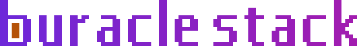

<p align="center">
  <picture>
    <source media="(prefers-color-scheme: dark)" srcset="assets/buracle-dark.svg">
    
  </picture>
</p>

<p align="center"><a href="README.md">English</a> · <b>Türkçe</b></p>

<div align="center">

### Tek mühendislik kurulumu, tek hafıza, bütün kodlama ajanların

Buracle Stack, kodlama ajanlarını bir araya getiren katmandır. Ajanlarına aynı skill'leri, MCP sunucularını, hook'ları ve korumaları verir. Ajanlar tek bir hafızayı paylaşır, iş akışları da kanıtla biter.

macOS · Linux, x64 ve arm64

```sh
curl -fsSL https://stack.buracle.dev/install.sh | bash
```

[](https://github.com/burakarslan0110/Buracle-Stack/actions/workflows/ci.yml)
[](https://github.com/burakarslan0110/Buracle-Stack/releases/latest)
[](LICENSE)
[](https://bun.sh)

[Kılavuz](https://stack.buracle.dev/tr/) · [Kurulum](https://stack.buracle.dev/tr/install/) · [İş akışları](https://stack.buracle.dev/tr/workflows/) · [Hafıza](https://stack.buracle.dev/tr/memory/) · [Komutlar](https://stack.buracle.dev/tr/commands/)

</div>

<p align="center">
  <a href="https://stack.buracle.dev/tr/"></a>
</p>

<p align="center">      </p>

## Ne işe yarar

Bugün Claude Code, yarın Codex, yan projede OpenCode kullanıyor olabilirsin. Her birinin kendi yapılandırma biçimi, kendi skill klasörü ve kendi hafızası var, zamanla birbirlerinden kopuyorlar. Buracle Stack tek bir kurulumu saklar ve onu Claude Code, Codex CLI, OpenCode, Oh My Pi, Qwen Code, Pi ve AGY CLI'a yazar.

- Tek kurulum: skill'ler, kurallar, MCP sunucuları, hook'lar ve durum satırları `canonical/` içinde durur. `buracle install` her ajanın kendi biçimini yazar, dokunduğu her ajan için yedek, günlük ve geri alma kaydı tutar.
- Tek hafıza: bilgisayarındaki bir CortexDB dosyası. İçinde her proje için bir beyin, bir de sana ait bir beyin var. Bir ajanda verdiğin karar, ötekini açtığında da orada olur.
- Kanıtla biten iş akışları: `/requirements` bulanık bir fikri onaylanmış bir PRD'ye çevirir. `/plan-build`, `/goal-build` ve `/bugfix` her davranış değişikliğine başarısız bir testle başlar, bağımsız bir incelemeden geçer ve sonuç kanıtlanınca biter.
- Korumalar: hook'lar yıkıcı komutları engeller, geri alması zor komutlardan önce sorar ve gizli bilgileri maskeler. Böylece ajanlar onay penceresi beklemeden çalışır.
- Araçlar: dokuz MCP sunucusu ve altı dil sunucusu. Yönlendirme her soruyu doğru araca gönderir.
- Buracle Stack Konsolu: hafızayı, plan incelemelerini ve iş akışı ayarlarını yönettiğin yerel bir web sayfası.

## Kurulum

macOS ya da Linux (Windows ve WSL desteklenmiyor), git, curl ve yedi ajandan en az biri gerekir. Buracle Stack bulduğu her ajanı kurar.

```sh
curl -fsSL https://stack.buracle.dev/install.sh | bash
```

Betik gerekirse Bun'ı kurar, `main` dalını `~/buracle` klasörüne klonlar ve `buracle install` komutunu çalıştırır. Sudo ya da paket yöneticisi çalıştırmaz. Betiği yeniden çalıştırınca kurulum güncellenir ve onarılır. Çalıştırmadan önce [betiği okuyabilirsin](scripts/install.sh). Bütün gereksinimler [kurulum kılavuzunda](https://stack.buracle.dev/tr/install/) yazıyor.

## İlk adımlar

1. Açık her Claude Code oturumunda `/reload-plugins` çalıştır, diğer ajanlara bir kez giriş yap.
2. Her projede `buracle project sync` çalıştır. Komut bir `AGENTS.md` olup olmadığına bakar, projenin skill'lerini bağlar ve projenin beynini kurar.
3. Ajanından işini her zamanki gibi iste ya da bir iş akışı başlat: `/plan-build API'ye istek sınırı ekle`. Codex'te `$plan-build`, Pi'de `/skill:plan-build` yaz.

`buracle update` en yeni sürümü getirir, `buracle doctor` sorunları çözüm yollarıyla gösterir, `buracle uninstall` yalnızca Buracle Stack'in yazdıklarını kaldırır. Hafızan yerinde kalır.

## Belgeler

[stack.buracle.dev](https://stack.buracle.dev/tr/) adresindeki kılavuzun Türkçe ve İngilizce sürümü var.

| Sayfa | İçerik |
|---|---|
| [Kurulum](https://stack.buracle.dev/tr/install/) | Gereksinimler, kurulumun neleri değiştirdiği, ilk adımlar |
| [İş akışları](https://stack.buracle.dev/tr/workflows/) | Dört iş akışı, durdurma koruması, worktree'ler ve diğer komutlar |
| [Hafıza](https://stack.buracle.dev/tr/memory/) | Beyin, oturumun neyi yükleyip neyi kaydettiği, yedekler ve gizlilik |
| [Konsol](https://stack.buracle.dev/tr/console/) | Yerel web sayfası ve iş akışı ayarları |
| [Korumalar](https://stack.buracle.dev/tr/guards/) | Neyin engellendiği, neyin önce sorulduğu, kendi kalıpların |
| [Araçlar](https://stack.buracle.dev/tr/tools/) | MCP sunucuları, dil sunucuları ve araç takımı |
| [Harness'lar](https://stack.buracle.dev/tr/harnesses/) | Her ajana ne geldiği, harness sınırları ve en düşük sürümler |
| [Komutlar](https://stack.buracle.dev/tr/commands/) | `buracle` komutu |
| [Güncelleme](https://stack.buracle.dev/tr/update/) | Güncelleme, sağlık denetimi, kaldırma ve sık karşılaşılan sorunlar |

Tasarımı [ARCHITECTURE.md](ARCHITECTURE.md), her ajanda neyin doğrulandığını [COMPATIBILITY.md](COMPATIBILITY.md) anlatır. İkisi de İngilizce.

## Açık kaynak üzerine kurulu

Buracle Stack aşağıdaki projeleri kurar ve birbirine bağlar. Her projenin kendi lisansı geçerlidir, adlar ve logolar sahiplerine aittir. Hepsinin listesi [Açık kaynak](https://stack.buracle.dev/tr/credits/) sayfasında.

| Proje | Buracle Stack'teki işi | Lisans |
|---|---|---|
| [CortexDB](https://github.com/liliang-cn/cortexdb) | Hafızayı saklar: her proje için bir beyni, bir de sana ait bir beyni olan tek bir dosya | MIT |
| [Context7](https://github.com/upstash/context7) | Güncel kütüphane ve çatı belgeleri | MIT |
| [CodeGraph](https://github.com/colbymchenry/codegraph) | Semboller, çağıranlar ve bir değişikliğin etkisi | MIT |
| [Semble](https://github.com/MinishLab/semble) | Anlamsal kod araması | MIT |
| [Open-WebSearch](https://github.com/Aas-ee/open-webSearch) | API anahtarı istemeyen web araması | Apache-2.0 |
| [Fetcher MCP](https://github.com/jae-jae/fetcher-mcp) | Web sayfalarını başsız bir tarayıcıda okur | MIT |
| [Grep by Vercel](https://grep.app) | Açık GitHub depolarından kod örnekleri | Barındırılan hizmet |
| [Chrome DevTools MCP](https://github.com/ChromeDevTools/chrome-devtools-mcp) | Bir Chrome tarayıcısını yönetir | Apache-2.0 |
| [Bun](https://github.com/oven-sh/bun) | Buracle Stack'i çalıştırır | MIT |
| [beautiful-mermaid](https://github.com/lukilabs/beautiful-mermaid) | Konsol'un inceleme sayfasındaki diyagramları çizer | MIT |

Dil sunucuları Pyright, typescript-language-server, gopls, rust-analyzer, csharp-ls ve Eclipse JDT LS'tir. Araç takımına ripgrep, ast-grep, jq, GitHub CLI, Ruff, ShellCheck, golangci-lint, tmux, uv ve Node.js de eklenir.

## Geliştirme

```sh
bun install
bunx tsc --noEmit -p .
T=$(mktemp -d) && HOME=$T BURACLE_HOME=$T/.buracle bun src/cli/main.ts build --check
bun test
```

CI bu komutları macOS (arm64) ve Linux (x64) üzerinde çalıştırır. Geliştirme `dev` dalında yapılır. Testlerden geçen ve yayımlanan dosyaları değiştiren her push, `main` dalında yeni bir sürüm yayımlar. Değişiklik göndermeden önce [`AGENTS.md`](AGENTS.md), [`CONTRIBUTING.md`](CONTRIBUTING.md) ve [`SECURITY.md`](SECURITY.md) dosyalarını oku. Bir hata bulursan ya da bir özelliği eksik görürsen [issue aç](https://github.com/burakarslan0110/Buracle-Stack/issues).

## Lisans

[MIT](LICENSE).
