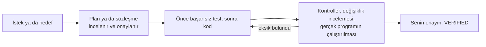
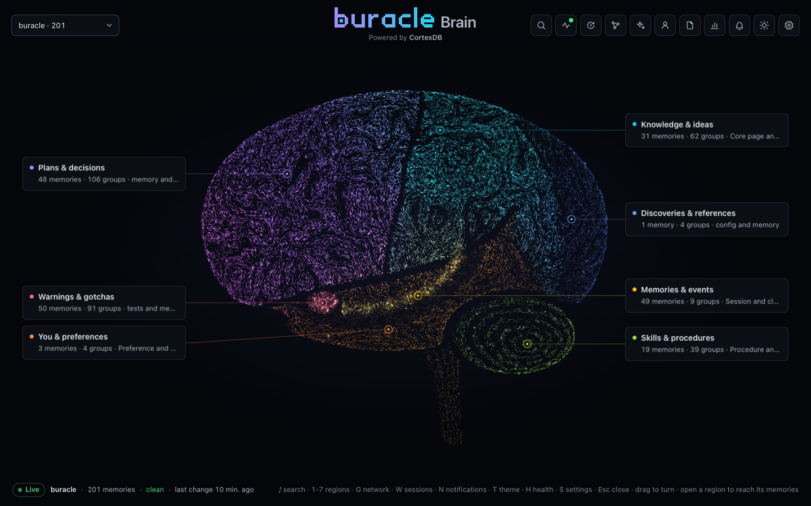
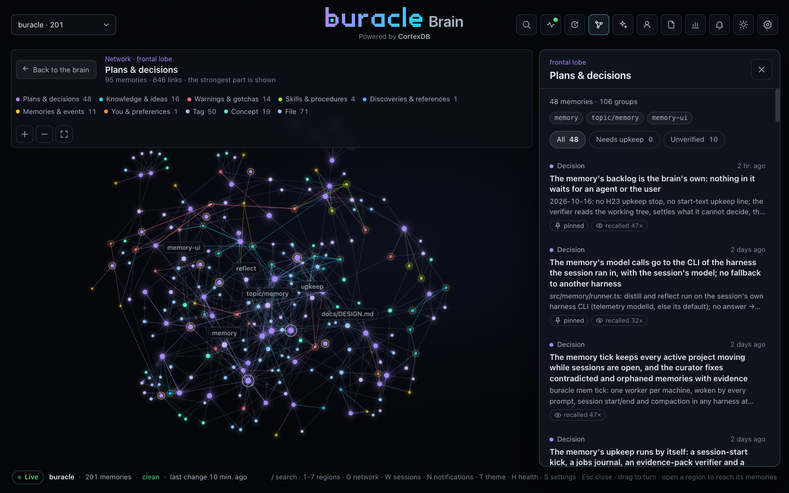
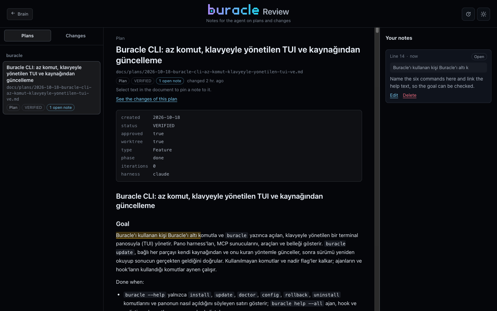
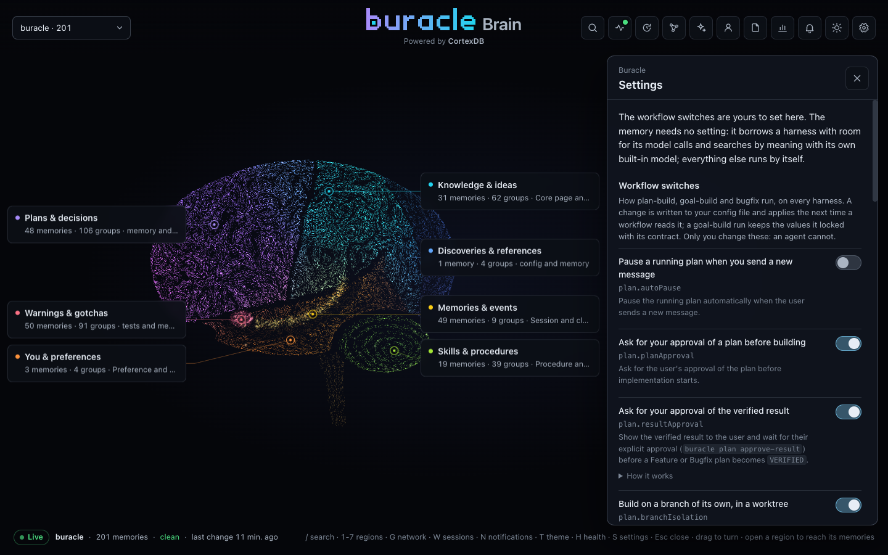

<p align="center">
  <picture>
    <source media="(prefers-color-scheme: dark)" srcset="assets/buracle-dark.svg">
    
  </picture>
</p>

<p align="center"><a href="README.md">English</a> · <b>Türkçe</b></p>

<div align="center">

### Claude Code, Codex CLI, OpenCode ve Oh My Pi için tek bir mühendislik kurulumu

Kullandığın her kodlama ajanında ortak hafıza, kanıtla biten workflow'lar, aynı araçlar ve aynı korumalar.

[](https://github.com/burakarslan0110/buracle/actions/workflows/ci.yml)
[](https://github.com/burakarslan0110/buracle/releases/latest)
[](LICENSE)
[](https://bun.sh)

[Kurulum](#kurulum) · [Neden Buracle](#neden-buracle) · [Workflow'lar](#workflowlar) · [Beyin](#beyin) · [Ayarlar](#ayarlar) · [Harness'lar](#her-harnessa-ne-gelir)

macOS · Linux · Windows, x64 ve arm64

</div>

## Neden Buracle

Claude Code, Codex CLI, OpenCode ve Oh My Pi'nin her birinin kendi yapılandırma biçimi, kendi hook'ları, kendi hafızası ve skill için kendi anlayışı var. Birden fazlasını kullanıyorsan her birini elle kurarsın ve hiçbiri ötekinde neye karar verdiğini bilmez.

Buracle dördünü tek bir kaynaktan kurar ve aynı çizgide tutar.

- Bütün ajanlar tek bir hafızayı paylaşır. Her projenin bir beyni var, senin de projeden projeye seninle gelen bir beynin var. Claude Code'da kaydedilen bir karar, ertesi sabah Codex'i açtığında orada olur.
- Workflow'lar bir sözleşmeyle çalışır. `/plan-build`, `/goal-build`, `/bugfix` ve `/requirements` kalıcı dosyalar yazar, gereken yerde onayını bekler, önce başarısız olan testi yazar, bağımsız incelemeler çalıştırır ve sonuç doğrulanana kadar devam eder.
- Korumalar onay sorusuz çalışmayı güvenli kılar. Hook'lar yıkıcı komutları engeller, geri alınması zor komutlardan önce harness'ın kendi penceresinde sorar, gizli bilgileri korur ve araç çıktısında maskeler.
- Her soru doğru araca gider. On MCP sunucusu ve altı dil sunucusu kurulup harness'lara bağlanır. Yönlendirme hook'ları her soruyu onun için yapılmış sunucuya gönderir.
- Her şeyin tek bir kaynağı var. Skill'ler, kurallar, inceleme ajanları, hook'lar ve MCP ayarları `canonical/` klasöründe durur. `buracle install` her harness'ın kendi biçimini yedekleyerek, günlüğe yazarak ve geri alma desteğiyle kurar.
- Bir kontrol paneli de var. Buracle Brain web arayüzü hafızayı, planlar ve diff'ler için bir inceleme sayfasını, dört harness'taki oturumları, kullanımı ve ayarları gösterir.

## Kurulum

### Başlamadan önce

En az bir harness kur: [Claude Code](https://code.claude.com/docs/en/quickstart), [Codex CLI](https://developers.openai.com/codex/cli), [OpenCode](https://opencode.ai) ya da [Oh My Pi](https://www.npmjs.com/package/@oh-my-pi/pi-coding-agent). Buracle bulduğu her harness'ı kurar, olmayanları atlar. Betik eksikse Bun'ı, Windows'ta da Git'i kurar. Git ve curl'ü (Linux'ta unzip'i ve Node.js yoksa, kurulumun indirdiği Node.js için libatomic1'i de) sen kurarsın: betik sudo'yu ya da paket yöneticisini asla çalıştırmaz, Linux'ta eksik olanı dağıtımında hangi komutla kuracağını yazar. Node.js, uv, ripgrep ve jq Homebrew, winget ya da scoop varsa onunla gelir; yoksa kurulum Buracle'ın sabitlediği sürümü indirir, birlikte sabitlenen sha256 ile doğrular ve `~/.buracle/toolchain/system` altında tutar.

### Kurulum komutları

macOS ve Linux:

```sh
curl -fsSL https://github.com/burakarslan0110/buracle/releases/latest/download/install.sh | bash
```

Windows (PowerShell):

```powershell
irm https://github.com/burakarslan0110/buracle/releases/latest/download/install.ps1 | iex
```

İki betik de GitHub'daki en son release'den gelir. Windows'ta her şey senin kullanıcına, yönetici izni olmadan kurulur. Araçlar `winget --scope user` (ya da scoop) ile gelir, dizin bağlantıları junction olur. Tek istisna Visual C++ çalışma zamanıdır. Bunu codegraph ve ast-grep ister ve çoğu Windows makinesinde zaten vardır. Eksikse betik onu yalnızca yönetici olarak açılmış bir terminalde kurar, aksi hâlde kurulum komutunu yazar. Betik Buracle'ın `main` dalını `~/buracle` klasörüne klonlar, bağımlılıklarını kurar, ardından `buracle install` çalıştırır. Bu komut nadir sorularını doğrudan terminalde sorar (`curl … | bash` altında da), `~/.local/bin` klasörünü PATH'e ekler (kabuğunun başlangıç dosyasına işaretli bir blok; Windows'ta kullanıcı PATH'i) ve hafıza web arayüzünü başlatır. Sonunda kısa bir özet gösterir: Prerequisites, Buracle, Harnesses, Tools, Memory ve Result için birer satır, geçmeyen her şey için de bir satır. Sağlık denetimi dahil her ayrıntı `~/.buracle/logs/install-<tarih>.log` dosyasına gider; Result satırı bu dosyayı gösterir. `main` dalı yayımlanan dosyaları tutar. CI bu dala yalnızca bir release yayımlarken ve test paketi olmadan yazar. `buracle update` de bu dalı izler. Betiği yeniden çalıştırırsan depo güncellenir ve kurulum onarılır. İki betik de çalıştırmadan önce okunacak kadar kısa ([`install.sh`](scripts/install.sh), [`install.ps1`](scripts/install.ps1)).

Kurulumdan sonra:

1. Açık olan Claude Code oturumlarında `/reload-plugins` çalıştır. Diğer harness'larda bir kez oturum aç (`codex login`, `opencode auth login`, `omp login`).
2. Her projede `buracle project init` çalıştır. Bu komut projeyi beynine eşler ve skill'lerini her harness için bağlar.
3. Buracle'ın, harness'ların ve araçların en yeni sürümünü istediğinde `buracle update` çalıştır.

<details>
<summary><b><code>buracle install</code> ne yapar</b></summary>

1. Önce harness dosyalarını `canonical/` ve `src/` klasörlerinden üretir. Derleme başarısız olursa hiçbir şey kurulmaz.
2. Depoyu `~/.buracle/runtime/<id>` altına kopyalar ve kopyayı sınar. `--version` çalışmalı, Claude Code ve Codex hook'ları da `rm -rf ~` komutunu reddedip `ls` komutuna izin vermelidir. `buracle` komutu ancak bundan sonra yeni kopyaya geçer. Önceki kopya geri alma için saklanır.
3. Eksik sistem araçlarını Homebrew (macOS'ta, Homebrew kuruluysa Linux'ta da), winget ya da scoop (Windows) ile kurar. Bunların hiçbiri kuramıyorsa Node.js, uv, ripgrep ve jq sabitlenmiş sürümüyle indirilir, sabitlenen sha256 ile doğrulanır, bir kez çalıştırılır ve `~/.local/bin` altına bağlanır. Linux'ta Homebrew yoksa eksik diğer araçları yalnızca dağıtımın komutuyla birlikte bildirir. Her MCP sunucusunu ve dil sunucusunu `~/.buracle/toolchain` altına kurar. CortexDB dahil her şey en yeni sürümüyle gelir. Yeni bir CortexDB sürümü yalnızca hafızanın denetiminden geçtikten sonra ve beyinler yedeklendikten sonra kullanılır. `update.minReleaseAgeDays` (varsayılan 0) bir sürümden sonra birkaç gün beklemeyi sağlar.
4. `~/.buracle/bin/buracle` komutunu, onun `~/.local/bin/buracle` bağlantısını, `~/.buracle/config.yaml` dosyasını ve `~/.agents/skills` altındaki ortak skill'leri yazar.
5. Her harness'ı kendi işlemiyle (transaction) kurar. İşlem yedek, atomik yazma, günlük, komutlar, doğrulama, sahiplik kaydı ve onay adımlarından geçer. Bir harness başarısız olursa yalnızca o harness geri alınır.
6. Son olarak `~/.buracle/brain` hafıza klasörünü oluşturur.

Elle değiştirdiğin değerler korunur ve raporlanır. Terminalde değişiklikleri hemen uygular ve her adımı gösterir. Betikler ve ajanlar `--yes` ekler.

</details>

<details>
<summary><b>Güncelleme, geri alma, kaldırma</b></summary>

- `buracle update` Buracle'ı, skill'leri, MCP sunucularını, Claude Code eklentilerini, harness'ları, araçları ve fiyat listesini denetler ve her parçayı kendi kaynağından günceller. Her harness onu kuran yükleyiciyle (Homebrew, npm, bun ya da kendi güncelleyicisi) güncellenir ve sürümü ardından yeniden okunur. `--check` yalnızca denetler. İsim verirsen kapsam daralır (`buracle update codex mcp`). Araç zinciri yükseltmesi kendini kanıtlamak zorundadır. MCP sunucusu başlayıp cevap vermeli, araç sürüm kontrolünü çalıştırmalı. Bunu yapamayan, araç zincirinin sakladığı önceki sürüme döner.
- `buracle rollback` en son kurulumu yedeklerinden geri alır. `buracle rollback toolchain` araç zincirinin önceki sürümlerini geri getirir.
- `buracle uninstall` yalnızca sahiplik kaydının Buracle'ın yazdığını kanıtladığı şeyleri, kurulumun kabuk başlangıç dosyana eklediği PATH bloğunu ve indirdiği sistem araçlarını kaldırır. Senin değiştirdiğin değerler kalır ve `~/.buracle/brain` altındaki hafızaya hiç dokunulmaz.

</details>

## İlk adımlar

Bir projede harness'ını aç ve her zamanki gibi çalış. Buracle kurallarını, hafızasını ve araçlarını oturumun çevresine yükler. Üç çalışma biçimi yan yana durur ve üçü de aynı korumalarla, aynı hafızayla çalışır.

| Çalışma biçimi | Ne kazanırsın |
|---|---|
| Doğrudan istek | Ajan Buracle'ın kurallarına ve hafızasına uyarak işi anlar, değiştirir, doğrular ve raporlar |
| Harness'ın kendi plan modu | Onayladığın plan `docs/plans/` altına kaydedilir ve oturum bitince kaybolmaz (OpenCode taslak olarak kaydeder) |
| Bir Buracle workflow'u | Kalıcı bir plan, sözleşme ya da PRD, onay kapıları, önce test, bağımsız incelemeler ve doğrulama |

Her depoda bir kez `/project-rules` çalıştır. Bu komut kodu okur, belgelediği komutları çalıştırır ve her harness'ın uyduğu bir `AGENTS.md` yazar. Codex'te bu sayfada `/` yazan yerlere `$` yaz.

## Workflow'lar

| Workflow | Ne zaman | Ne kazanırsın |
|---|---|---|
| `/plan-build` | Koddan önce incelenmiş bir planı onaylamak istediğinde | `docs/plans/` altında bir plan, plan incelemesi, her değişiklikten önce başarısız olan bir test, değişiklik incelemesi, değişen her yüzeyde gerçek programın çalıştırılması, uçtan uca senaryolar ve sonuç için senin onayın |
| `/goal-build` | Varılacak nokta belli ama yol geliştirirken bulunacaksa | `docs/builds/` altında geçti/kaldı ölçütleri kilitlenmiş bir sözleşme, eksik kanıtın kaldı sayıldığı geliştirme ve değerlendirme turları, sonda da bir doğrulama aşaması |
| `/bugfix` | Bir davranış bozuksa ve düzeldiğinin kanıtını istiyorsan | Önce hatanın yeniden üretilmesi, kök nedenin `file:line` olarak gösterilmesi, düzeltmeden önce başarısız olan bir test, hatanın başladığı yerde düzeltme, değişiklik incelemesi ve uçtan uca kontrol |
| `/requirements` | Sorun, hedef kitle ya da kapsam henüz belirsizse | Birkaç tur soru, araştırma ve `docs/prd/` altında, doğru geliştirme workflow'una devreden onaylı bir PRD |



Bu workflow'ları bir arada tutan parçalar şunlar:

- Durdurma koruması (stop guard), plan doğrulanana kadar turun bitmesine izin vermez. Turu yalnızca bir duraklatma bitirir. İstediğin an "dur" ya da "bekle" diyerek duraklatabilir, "devam et" diyerek sürdürebilirsin. İngilizce karşılıkları da çalışır.
- İstekten sonra `--worktree`, `--new-branch` ya da `--current-branch` yazarak işin nerede yapılacağını belirlersin. Worktree'de yapılan iş bitince çıktığı dala squash merge ile birleştirilir.
- Ajan her onaydan önce inceleme sayfasına iliştirdiğin notları okur ve her birini uygulandı olarak işaretler.
- `buracle plan audit` diff'i her görevin adını verdiği dosyalarla karşılaştırır ve hiçbir görevin planlamadığı değişiklikleri işaretler.
- `plan.reviews.companion` açıksa aynı inceleme kurulu başka bir harness'ta da salt okunur bir ikinci görüş olarak çalışır.
- Birbirinden bağımsız planlar paralel kollar (lane) hâlinde, her biri kendi worktree'sinde çalışabilir. Kollar bağımlılık sırasına göre birleştirilir.

Bu workflow'ların nasıl çalışacağını web arayüzünün [ayarlarından](#ayarlar) ya da `buracle config set plan.<key> <value>` komutuyla belirlersin.

### Diğer workflow'lar

| Komut | Ne yapar |
|---|---|
| `/research <soru>` | Web, kütüphane belgeleri, açık kod ve hafıza üzerinden kaynak gösteren bir araştırma yapar. Her kaynağı göstermeden önce okur |
| `/inspect <soru>` | Bir soruyu gerçekten çalışan kod boyunca izler, her adımı `path:line` olarak gösterir, kendi yanıtını çürütmeye çalışır ve ne kadar emin olduğunu söyler. Hiçbir şeyi değiştirmez |
| `/dead-code` | Kullanılmayan kodu raporlar. Bir adayın iki bağımsız kanıtı olmalıdır ve sonuç aşamalı bir kaldırma planıdır. Hiçbir şeyi değiştirmez |
| `/security-audit` | Cloudflare'in güvenlik skill'iyle odaklı rehberlik ya da bulgular ve raporla biten altı aşamalı bir denetim yapar |
| `/project-rules` | Çalıştırdığı komutlara dayanarak `AGENTS.md`, iç içe `AGENTS.md` dosyaları ve yol kuralları yazar ve denetler |
| `/new-skill` | Tekrar eden bir işi eval'leriyle birlikte bir skill hâline getirir ve lint'ten geçirir |
| `/find-skill` | Kendi skill'lerini ve skills.sh kayıt defterini lisans, güncellik ve risk puanlarıyla tarar, seçileni denetler ve her harness için kurar |
| `/ab-test` | Bir skill ya da kural değişikliğinin ajanın davranışını değiştirip değiştirmediğini, geçici yapılandırma klasörlerinde eşleştirilmiş önce/sonra denemeleriyle ölçer |

| Yardımcı komut | Ne yapar |
|---|---|
| `/brain` | Buracle Brain web arayüzünü açar. `/brain review` inceleme sayfasını açar |
| `/remember <metin>` | Hafızaya bir not kaydeder |
| `/aside <soru>` | Asıl işi bölmeden yan bir soruyu yanıtlar |
| `/buracle-status` | Planı, workflow'u ve hafızayı tek bakışta gösterir |

### Kurallar

Her oturumda dört kural yüklenir. Bunlar core (otonomi, "bitti" demeden önce kanıt, test, değişiklik disiplini, hata ayıklama), tooling (hangi sorunun hangi araçla yanıtlanacağı), memory ve plain language (sade dil) kurallarıdır. Yol kuralları ise ajan eşleşen dosyalara dokunduğunda yüklenir. TypeScript, Python, Go, .NET, Blazor, frontend, tarayıcı otomasyonu, backend ve mobil için yol kuralı var.

## Beyin



Buracle'ın hafızası tek bir [CortexDB](https://github.com/liliang-cn/cortexdb) dosyasında, `~/.buracle/brain/brain.db` içinde durur. Her proje için bir bölme (bucket), senin için de ayrı bir bölme vardır. Her harness ona `buracle-memory` MCP sunucusu üzerinden ulaşır. Sunucunun altı aracının (search, get, write, update, status, context) her birinin `buracle mem` altında bir CLI karşılığı var. Beyin hafıza kayıtlarını yedi bölgeye ayırır.

| Bölge | Ne tutar |
|---|---|
| Plans & decisions | Gerekçeleri ve reddedilen seçenekleriyle birlikte kararlar |
| Knowledge & ideas | Proje bilgisi ve eski bir Buracle ile kurulmuş projelerin çekirdek sayfaları (brief, architecture, conventions, commands, glossary, progress) |
| Discoveries & references | Saklamaya değer bağlantılar ve kaynaklar |
| You & preferences | Tercihlerin ve projenin kendi kuralları |
| Skills & procedures | Çözülmesi emek isteyen prosedürler |
| Warnings & gotchas | Kolay görülmeyen hatalar ve kök nedenleri |
| Memories & events | Oturumlar, devir notları (handoff) ve dosyalanmayı bekleyen kayıtlar |

0.5'ten yükseltiyorsan: [MIGRATION.md](MIGRATION.md) (taşımanın ne yaptığı, nasıl kontrol edilir, nasıl geri dönülür). Hafızanın neden böyle olduğu ve ölçümler: [ARCHITECTURE.md](ARCHITECTURE.md). Her harness ve işletim sisteminin neyi desteklediği ve neyin doğrulandığı: [COMPATIBILITY.md](COMPATIBILITY.md).

### Ne yapar, ne zaman

- Bir oturum başladığında ajan tercihlerini, projenin önemli hafıza kayıtlarını ve iş yarım kaldıysa nerede durduğunu anlatan bir devir notunu alır. O anda yalnızca okuma yapılır.
- Sen çalışırken söylediğin tercihler ("her zaman", "asla", "bundan sonra") kısa ve maskelenmiş bir alıntıyla oturumun spool dosyasına not edilir.
- Bağlam sıkıştırılmadan önce plan, görev ve yapılacaklar durumu bir devir notuna yazılır ve sıkıştırmadan hemen sonra geri gelir.
- Oturum bitince tek bir `buracle mem finalize` çalışması oturumun hafıza kaydını yazar, söylediğin tercihleri hiçbir model kullanmadan açık (explicit) kayıtlar olarak dosyalar ve kullandığın harness'ın modeline saklamaya değer kararları, tuzakları ve prosedürleri sorar. Modelin cevabı, bir şey yazılmadan önce bütün olarak denetlenir. Emin olunan bulgular modelin güven puanıyla birlikte çıkarım (inferred) olarak işaretlenmiş hafıza kaydı olur, gerisi dosyalanmayı bekler. Senin bir kaydına (açık, sabitlenmiş ya da doğrulanmış) benzeyen bir bulgu o kaydı asla değiştirmez: yanına, çelişiyor diye işaretlenerek yazılır. Aynı çalışma, yakalaması hâlâ bekleyen en fazla üç eski oturumu da alır.
- `buracle mem capture` aynı işi istediğin an yapar, `buracle mem doctor` hâlâ bekleyenleri listeler.

Arka planda başka hiçbir şey çalışmaz: zamanlayıcı, açılış işi, onarım ya da temizlik turu yok. Oturumlar ve devir notları kendiliğinden silinir, çünkü CortexDB onları 45 ve 14 gün sonra düşürür. `buracle mem backup` istediğinde beyin dosyasının tamamını kopyalar; bir oturum bittiğinde de en yeni kopya bir günden eskiyse bir kopya daha alınır (en yeni 10 kopya tutulur).

Model çağrıları zaten kullandığın bir harness'ın CLI'ı üzerinden yapılır, bu yüzden API anahtarı gerekmez. Önce oturumun kendi harness'ı denenir. 5 saatlik kullanımı %75'i ya da haftalık kullanımı %85'i aşan harness atlanır. Arama kelimelerle yapılır ve İngilizce ile Türkçe kelime biçimlerini bilir.

Gizli bilgiler yazılmadan önce maskelenir, `<private>…</private>` blokları hiç saklanmaz ve `memory.exclude` listesindeki klasörler hiç kaydedilmez. Devreden çıkarılmış bir kayıt sen silene kadar aramalardan gizli kalır, böylece geri getirebilirsin. `buracle mem export` ve `buracle mem import` kayıtları JSON satırları olarak taşır. `buracle mem restore` bir yedeği geri getirir.

### Buracle Brain web arayüzü



`/brain` ya da `buracle mem ui --open` arayüzü `http://localhost:41777` adresinde açar. Arayüz sen çalışırken açık kalır: kurulum onu başlatır, dört harness'tan birinde bir oturum başlayınca kapalıysa açılır ve bir harness oturumu açık olduğu sürece çalışır. Son oturum kapanınca yaklaşık bir dakika içinde durur; hiç oturum açılmamışsa 30 dakika boyunca istek gelmezse kendini kapatır (`BURACLE_UI_IDLE_MS` bunu milisaniye olarak değiştirir). `buracle mem ui --stop` onu bir sonraki oturum başlangıcına kadar durdurur. `buracle config set memory.ui.autostart false` eski elle kullanımı geri getirir: arayüz yalnızca `buracle mem ui` ile açılır ve boşta kalma süresinden sonra kapanır.

- Beyin görünümü bölgeleri bir beyin olarak çizer ve yazma ile arama anında burada yanar. `/` arama yapar, `1` ile `7` arasındaki tuşlar bir bölgeyi açar, `G` kayıtların, etiketlerin, dosyaların ve kavramların ağını gösterir.
- Kayıt ayrıntısında metin, etiketler, kaynaklar, geçmiş, kaydın nereden geldiği (senin sözlerin mi, çıkarım mı, hangi güvenle) ve bağlantılı olduğu kayıtlar görünür. Kaydı buradan düzeltebilir, devreden çıkarabilir, geri getirebilir ya da silebilirsin. Düzeltme senin kendi sözün olarak saklanır.
- İnceleme sayfası planlarını, geliştirme sözleşmelerini, PRD'lerini ve ajanın diff'ini gösterir. Bir metni seçerek ya da bir satır numarasına tıklayarak ajana not iliştirirsin.
- Sağlık panelinde (`H`) sorunlar sade bir dille anlatılır. Panel depoyu ve sürümünü, beyin dosyasını boyutu ve kovalarıyla, Buracle 0.5'ten taşımayı, dosyalanmayı bekleyen kayıtları, son yakalamayı ve yedekleri gösterir. Back up düğmesi de buradadır.
- Oturumlar ve kullanım panelinde (`W`) dört harness'taki son 30 günün oturumları görünür. Burada yalnızca sayılar tutulur, yazdıkların asla tutulmaz. Panel ayrıca giren commit'leri, güne ve modele göre maliyeti ve token'ları, kurulu skill'leri, ajanları ve kuralları gösterir.
- Bildirimler (`N`) ile koyu ve açık tema (`T`) da arayüzde yer alır.



Sayfa yalnızca kendi yerel sunucusuna giden ve token ile denetlenen isteklerle yazar.

#### Ayarlar



Ayarları açmak için `S` tuşuna bas. Ayarlar iki gruptan oluşur.

Workflow anahtarları plan-build, goal-build ve bugfix'in her harness'ta nasıl çalışacağını belirler. Bunları buradan ya da `buracle config set plan.<key> <value>` komutuyla değiştirirsin. Ajanlar bu sayfayı kullanamaz. Onay, inceleme ve doğrulama anahtarlarını da hiçbir yoldan değiştiremez. Yaptığın değişiklik hemen `~/.buracle/config.yaml` dosyasına yazılır ve bir workflow ayarları bir sonraki okuduğunda geçerli olur. Çalışmakta olan bir goal-build ise sözleşmesiyle kilitlediği değerleri korur. Her anahtar kendi adını, kısa bir açıklamasını ve "How it works" altında ayrıntısını gösterir. Değer gelen varsayılandan farklıysa arayüz bunu da not eder.

| Ne yapar | Anahtar | Varsayılan |
|---|---|---|
| Yeni bir mesaj gönderdiğinde çalışan planı duraklatır | `plan.autoPause` | kapalı |
| Geliştirmeye başlamadan önce plan için onayını ister | `plan.planApproval` | açık |
| Doğrulanmış sonuç için onayını ister | `plan.resultApproval` | açık |
| İşi bir worktree içinde, kendine ait bir dalda yapar | `plan.branchIsolation` | açık |
| Planlarken netleştirici sorular sorar | `plan.questions` | açık |
| Planı bağımsız bir ajana inceletir | `plan.reviews.plan` | açık |
| Değişiklikleri bağımsız bir ajana inceletir | `plan.reviews.changes` | açık |
| goal-build sözleşmesini bağımsız bir ajana inceletir | `plan.reviews.goal` | açık |
| Başka bir harness'tan ikinci görüş alır | `plan.reviews.companion` | `off` (diğer seçenekler `auto`, `claude`, `codex`, `opencode`, `omp`) |
| Ölçütler geçtikten sonra goal-build'i doğrular | `plan.goalVerification` | açık |
| Onaydan sonra model değiştirebilmen için durur | `plan.modelSwitch` | `off` (diğer seçenek `manual`) |
| Planı harness'ın kendi plan modunda yazar | `plan.nativePlanMode` | `off` (diğer seçenek `on`) |

Model for capture grubu, hafızanın oturum sonu damıtması için bir harness ödünç alırken uyduğu kuralı gösterir. Bir harness bu çağrıyı ancak 5 saatlik penceresi %75'in, haftalık penceresi %85'in altındayken çalıştırır. Kuralın altında bir sonraki çağrıyı hangi harness'ın çalıştıracağını, her pencereden ne kadar kullandığını ve bekletilen bir harness'ın ne zaman serbest kalacağını görürsün. Bu grupta ayarlanacak bir şey yok.

Son satır web arayüzünün dinlediği portu ve yazdığı yapılandırma dosyasını gösterir.

## Her harness'a ne gelir

Dört harness da aynı 27 hook'u, skill'leri, inceleme ajanlarını, kuralları, hafızayı, korumaları ve durum satırı verisini alır. Değişen şey Buracle'ın harness'a nasıl bağlandığı ve her harness'ın neyi gösterebildiğidir.

| | Claude Code | Codex CLI | OpenCode | Oh My Pi |
|---|---|---|---|---|
| Nasıl bağlanır | Mod içeren bir eklenti | `hooks.json`, `config.toml` anahtarları, bir `AGENTS.md` bloğu ve exec-policy kuralları | Bir sunucu eklentisi ve bir TUI eklentisi | Eklenti (extension) içeren bir omp plugin'i |
| Workflow'lar | `/plan-build` | `$plan-build` | `/plan-build` | `/plan-build` |
| Yardımcı komutlar | `/brain`, `/remember`, `/aside`, `/buracle-status` | CLI karşılıkları, `/aside` Codex'in `/side` komutuna gider | Dördü de TUI'de, `/aside` `/btw` komutuna gider | Dördü de var |
| Onay | Claude Code içinde bir pencere | Codex'in kendi onay sorusu | Bir TUI penceresi, web ve masaüstünde question aracı | omp'nin seçim penceresi |
| Workflow ilerlemesi | İstem alanının üstünde bir bant, hafıza ve plan panelleri | tmux'taki durum çubuğu ve `buracle plan status` | Yazma alanının üstünde bir bant ve bir pencere | Editörün üstünde bir widget, altında bir panel |
| Durum satırı | Buracle'ın kendi durum satırı | Codex'in yerleşik öğeleri ve bir tmux çubuğu | İstem alanının alt satırı | omp'nin yerleşik düzeni ve Buracle girdileri |
| Plan modu | `docs/plans/` altına kaydedilir | Planı uygulamayı seçtiğinde kaydedilir | Taslak olarak kaydedilir | Onaylandığında kaydedilir |
| Dil sunucuları | Claude Code'un LSP'si | Buracle'ın `lsp` MCP sunucusu | Buracle'ın `lsp` MCP sunucusu | omp'nin kendi LSP'si |
| Tarayıcı | chrome-devtools | chrome-devtools | chrome-devtools | omp'nin yerleşik tarayıcısı |

Buracle Claude Code, Codex ve Oh My Pi'nin yerleşik hafızasını kapatır. Böylece dört harness'ın paylaştığı tek hafıza beyin olur. İnceleme ajanları her zaman salt okunur çalışır. Bir harness'ta Buracle'ın ihtiyaç duyduğu bir hook yoksa [`src/adapters/shared/host-limits.ts`](src/adapters/shared/host-limits.ts) bu eksiği ve yerine ne yapıldığını kaydeder. Daha yeni bir harness sürümü bu eksiği kapatabilecekse `buracle doctor` bunu söyler.

| Harness | Test edilen sürüm |
|---|---|
| Claude Code | 2.1.302 |
| Codex CLI | 0.162.1 |
| OpenCode | 2.0.30 |
| Oh My Pi | 18.10.1 |

## Korumalar

Buracle harness'ları onay soruları olmadan çalıştırır ve korumayı kendi hook'larına bırakır.

- Yıkıcı komutlar reddedilir. `/` ya da `~` üzerinde `rm -rf`, main dalına force push, `curl | sh`, `mkfs` ve bir aygıta `dd` bunlardan bazılarıdır.
- Gizli dosyalara (`.env` dosyaları, anahtarlar, kimlik bilgileri), `~/.ssh` ve `~/.aws` klasörlerine ve Buracle'ın kendi kurulumuna yazma reddedilir.
- Geri alınması zor komutlar (force push, `reset --hard`, rebase, amend, dal silme, `git clean`) harness'ın kendi penceresinde bekler. Sen bir kez izin verene, oturum boyunca izin verene ya da reddedene kadar çalışmazlar. Model önceki bir yanıtı yeniden kullanamaz.
- Araçların döndürdüğü çıktıdaki anahtarlar, token'lar ve parolalar model okumadan önce maskelenir.
- Claude Code ve Codex'te yüklenemeyen ya da karar veremeyen bir hook komutu reddeder ve `buracle doctor` komutunu önerir.

`~/.buracle/config.yaml` içindeki `guards.bash.extraDeny` ve `guards.write.protect` ayarlarıyla kendi kalıplarını ekleyebilirsin.

## Araçlar

| MCP sunucusu | Ne için |
|---|---|
| `buracle-memory` | Beyin |
| [`context7`](https://github.com/upstash/context7) | Kütüphane ve framework belgeleri |
| [`codegraph`](https://github.com/colbymchenry/codegraph) | Semboller, çağıranlar ve bir değişikliğin etkisi |
| [`semble`](https://github.com/MinishLab/semble) | Anlamsal kod arama |
| [`web-search`](https://www.npmjs.com/package/open-websearch) | API anahtarı istemeyen web araması |
| [`web-fetch`](https://www.npmjs.com/package/fetcher-mcp) | Web sayfalarını arayüzsüz (headless) bir tarayıcıda okur |
| [`grep`](https://grep.app) | Açık GitHub depolarından kod örnekleri |
| [`chrome-devtools`](https://github.com/ChromeDevTools/chrome-devtools-mcp) | Bir Chrome tarayıcısını yönetir |
| `lsp` | Codex ve OpenCode için dil sunucusu tanılamaları ve kod içinde gezinme |

Araç zinciri ayrıca `rg`, `ast-grep`, `jq`, `gh`, `tmux`, `ruff`, `shellcheck` ve `golangci-lint` araçlarını ve altı dil sunucusunu (pyright, typescript-language-server, gopls, rust-analyzer, csharp-ls ve jdtls) getirir. Oturum başlangıcı hiçbir dizinleme çalıştırmaz: Buracle bir projenin ilk codegraph dizinini codegraph sunucusu orada başlarken kurar, sonrasında codegraph ve semble kendi dizinlerini kendileri güncel tutar. Birden çok proje barındıran bir klasörde ajan, ihtiyaç duyduğu projenin dizinini `buracle index ensure --cwd <project>` ile kurar. Her düzenlemeden sonra ilgili denetleyici çalışır ve bulguları ajana geri döner.

Claude Code'da durum satırı şöyle görünür:

```
Opus 5.5 [xhigh] [1M] | ███░░░░░ 37% | 5h: 42% ↓ 1h20m | 7d: 18% ↓ 1d6h | ~/project | ⎇ main
plan-build ● Implement 3/7 | Rate limit the public API
Buracle 0.5.0 · CC 2.1.296 (Max) · Memory: localhost:41777 · brain 142 ✓ · idx ready
```

## buracle komutu

Terminalde `buracle` yazınca bir menü açılır. Menüde logo, her şeyin yolunda olup olmadığını söyleyen bir satır ve altı seçenek bulunur. Seçenekler kurulum ya da onarım, güncelleme, sağlık kontrolü, hafıza, her parçayı sürümü ve bekleyen güncellemesiyle gösteren ayrıntılı görünüm ve çıkıştır. Ok tuşları ya da j/k ile gezinir, Enter ile seçimi çalıştırırsın. Her seçeneğin kendi kısayol tuşu da var.

Menü açıkken Buracle, son doğrulaması altı saatten eski olanları yeniler. MCP sunucuları canlı olarak yoklanır, araçlar sürümünü bildirir, güncelleme denetimi yeniden çalışır. Sonucu gelene kadar satırda `checking…` yazar. Kontrol hiçbir şey indirmez. Paketi araç zincirinde olmayan sunucu `buracle install` komutunu bekler. Ayrıntılı görünümde `n` bakılması gereken sonraki satıra atlar, `r` her şeyi hemen yeniden kontrol eder.

| Komut | Ne yapar |
|---|---|
| `buracle install [<harness>…]` | Bulduğu her harness için ya da adını verdiklerin için ilk kurulumu ve onarımı yapar |
| `buracle update [--check]` | Her parçayı kendi kaynağından günceller |
| `buracle doctor [<konu>]` | Hook'ları, MCP sunucularını, hafızayı ve kod dizinlerini denetler. `mcp` ya da `memory` gibi bir konu verirsen yalnızca o parçaya bakar |
| `buracle config` | Yapılandırmayı `get`, `set` ve `unset` ile okur ya da değiştirir |
| `buracle rollback` | En son kurulumu geri alır |
| `buracle uninstall` | Buracle'ın kurduğu her şeyi kaldırır ve hafızaya dokunmaz |

Ajanlar `plan`, `worktree`, `mem`, `skills` ve `project` gibi başka komutlar da kullanır. `buracle help --all` hepsini listeler, `buracle help <komut>` birini açıklar.

## Geliştirme

```sh
bun install
bunx tsc --noEmit -p .
T=$(mktemp -d) && HOME=$T BURACLE_HOME=$T/.buracle bun src/cli/main.ts build --check
bun test
```

CI bu denetimleri macOS (arm64), Linux (x64) ve Windows (x64) üzerinde çalıştırır. Geliştirme `dev` dalında yapılır, bu yüzden geliştirmek için o dalı klonla. Orada bütün denetimler geçtiğinde ve yayımlanan dosyalar değiştiğinde CI bir sonraki sürümü kendisi seçer (0.5.0, 0.5.1, 0.5.2 ve devamı). O commit'i bu sürümle ve test paketi olmadan (`tests/` ve `bunfig.toml`) `main` dalına yazar. Ardından `v<sürüm>` release'ini bu commit'ten, iki kurulum betiği ekli olarak GitHub'da yayımlar. `main` dalında hiçbir denetim çalışmaz. Yeni bir sürüm serisi başlatmak için `package.json` içindeki ana ya da ara sürümü yükseltmen yeterli.

Değişiklik göndermeden önce [`AGENTS.md`](AGENTS.md), [`CONTRIBUTING.md`](CONTRIBUTING.md) ve [`SECURITY.md`](SECURITY.md) dosyalarını oku. Bir hata mı buldun ya da bir özellik mi eksik? [Bir issue aç](https://github.com/burakarslan0110/buracle/issues).

## Lisans

[MIT](LICENSE). `security-audit` skill'i Cloudflare'in [security-audit skill'idir](https://github.com/cloudflare/security-audit-skill). O da MIT lisanslıdır ve lisansı [`canonical/skills/security-audit/assets/`](canonical/skills/security-audit/assets/) klasöründedir.
