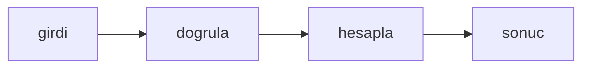

# Bayt sayısını okunur biçime çevir

## Hedef
Bir bayt sayısı, 1024 tabanlı birimlerle ve tek ondalık basamakla okunur bir metne çevrilir; bayt altındaki değerler ondalıksız yazılır ve negatif değer hata verir.

## Bağlam
- Depo küçük bir Bun projesidir; testler `bun test` ile koşar, kaynak dosyalar `src/` altında, testler `tests/` altındadır.
- `tests/bytes.test.ts` dosyası hazır ve şu an başarısız; `src/bytes.ts` henüz yoktur.

## Kapsam
- İçinde: `src/bytes.ts` dosyasının yazılması.
- Dışında: başka bir dosya, bağımlılık ya da yapılandırma değişikliği; test dosyasına dokunulmaz.

## Yaklaşım
Tek bir saf fonksiyon ya da sınıf; dış bağımlılık yok, girdi doğrulaması hata fırlatır.

## Tasks

### Task 1: Bayt sayısını okunur biçime çevir

**Objective:** `export function formatBytes(n: number): string` içeren `src/bytes.ts` dosyası yazılır ve mevcut test geçer.

**Files:**
- Create: `src/bytes.ts`
- Test: `tests/bytes.test.ts`

**Definition of Done:**
- `formatBytes(0)` "0 B", `formatBytes(999)` "999 B", `formatBytes(1536)` "1.5 KB", `formatBytes(1048576)` "1.0 MB" ve `formatBytes(5368709120)` "5.0 GB" döndürür; birimler B, KB, MB, GB ve TB olup 1024 tabanlıdır ve B dışındaki her birim tek ondalık basamakla yazılır.
- Negatif bir sayı için `Error("negative size")` fırlatılır.
- Test dosyası değiştirilmez; yalnızca `src/bytes.ts` oluşturulur.
- Verify: `bun test tests/bytes.test.ts`

- [ ] Task 1 done

## Riskler
- Yok.

## Varsayımlar
- Bun 1.4 ve TypeScript strict; test çalıştırıcısı `bun test`.
