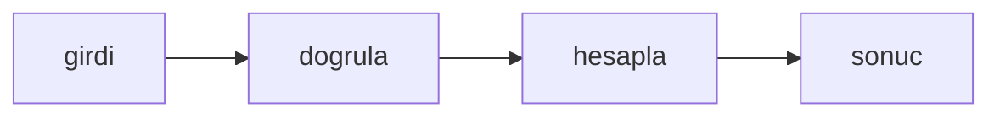

# Markdown ön bilgisini oku

## Hedef
Bir Markdown metninin başındaki iki --- çizgisi arasındaki anahtar: değer satırları bir nesneye okunur; ön bilgi bloğu yoksa ya da kapanmıyorsa hata verilir.

## Bağlam
- Depo küçük bir Bun projesidir; testler `bun test` ile koşar, kaynak dosyalar `src/` altında, testler `tests/` altındadır.
- `tests/frontmatter.test.ts` dosyası hazır ve şu an başarısız; `src/frontmatter.ts` henüz yoktur.

## Kapsam
- İçinde: `src/frontmatter.ts` dosyasının yazılması.
- Dışında: başka bir dosya, bağımlılık ya da yapılandırma değişikliği; test dosyasına dokunulmaz.

## Yaklaşım
Tek bir saf fonksiyon ya da sınıf; dış bağımlılık yok, girdi doğrulaması hata fırlatır.

## Tasks

### Task 1: Markdown ön bilgisini oku

**Objective:** `export function parseFrontmatter(markdown: string): Record<string, string>` içeren `src/frontmatter.ts` dosyası yazılır ve mevcut test geçer.

**Files:**
- Create: `src/frontmatter.ts`
- Test: `tests/frontmatter.test.ts`

**Definition of Done:**
- `parseFrontmatter("---\\ntitle: Hello\\nstatus: draft\\n---\\n# Hello\\n")` `{ title: "Hello", status: "draft" }` döndürür; değerlerin başındaki ve sonundaki boşluklar atılır, ilk iki nokta anahtarı değerden ayırır.
- Metin `---` ile başlamıyorsa ya da ikinci `---` satırı yoksa `Error("no frontmatter")` fırlatılır.
- Test dosyası değiştirilmez; yalnızca `src/frontmatter.ts` oluşturulur.
- Verify: `bun test tests/frontmatter.test.ts`

- [ ] Task 1 done

## Riskler
- Yok.

## Varsayımlar
- Bun 1.4 ve TypeScript strict; test çalıştırıcısı `bun test`.
