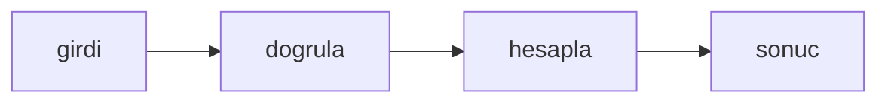

# Başlıktan slug üret

## Hedef
Bir başlıktan, Türkçe harfleri de doğru şekilde sadeleştirerek, URL'de kullanılabilecek küçük harfli ve tirelerle ayrılmış bir slug üretilir; boş başlık hata verir.

## Bağlam
- Depo küçük bir Bun projesidir; testler `bun test` ile koşar, kaynak dosyalar `src/` altında, testler `tests/` altındadır.
- `tests/slugify.test.ts` dosyası hazır ve şu an başarısız; `src/slugify.ts` henüz yoktur.

## Kapsam
- İçinde: `src/slugify.ts` dosyasının yazılması.
- Dışında: başka bir dosya, bağımlılık ya da yapılandırma değişikliği; test dosyasına dokunulmaz.

## Yaklaşım
Tek bir saf fonksiyon ya da sınıf; dış bağımlılık yok, girdi doğrulaması hata fırlatır.

## Tasks

### Task 1: Başlıktan slug üret

**Objective:** `export function slugify(title: string): string` içeren `src/slugify.ts` dosyası yazılır ve mevcut test geçer.

**Files:**
- Create: `src/slugify.ts`
- Test: `tests/slugify.test.ts`

**Definition of Done:**
- `slugify("Kurulum Başlar")` çağrısı `kurulum-baslar` döndürür; büyük harfler küçülür, Türkçe harfler (ı, ş, ğ, ü, ö, ç ve İ) temel harflerine indirgenir ve harf ya da rakam olmayan her dizi tek bir tire olur, baştaki ve sondaki tireler atılır.
- Boş ya da yalnızca boşluktan oluşan başlık için `Error("empty title")` fırlatılır.
- Test dosyası değiştirilmez; yalnızca `src/slugify.ts` oluşturulur.
- Verify: `bun test tests/slugify.test.ts`

- [ ] Task 1 done

## Riskler
- Yok.

## Varsayımlar
- Bun 1.4 ve TypeScript strict; test çalıştırıcısı `bun test`.
