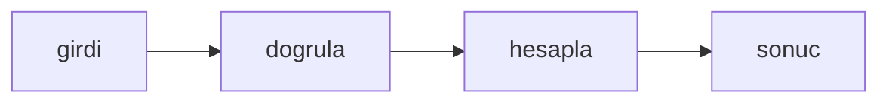

# Sabit pencereli istek sayacı

## Hedef
Her anahtar için sabit uzunlukta bir zaman penceresinde en fazla belirli sayıda isteğe izin veren bir sayaç yazılır; sınır aşıldığında istek reddedilir, yeni pencerede sayaç sıfırlanır ve pozitif olmayan bir sınır hatadır.

## Bağlam
- Depo küçük bir Bun projesidir; testler `bun test` ile koşar, kaynak dosyalar `src/` altında, testler `tests/` altındadır.
- `tests/window.test.ts` dosyası hazır ve şu an başarısız; `src/window.ts` henüz yoktur.

## Kapsam
- İçinde: `src/window.ts` dosyasının yazılması.
- Dışında: başka bir dosya, bağımlılık ya da yapılandırma değişikliği; test dosyasına dokunulmaz.

## Yaklaşım
Tek bir saf fonksiyon ya da sınıf; dış bağımlılık yok, girdi doğrulaması hata fırlatır.

## Tasks

### Task 1: Sabit pencereli istek sayacı

**Objective:** `export class FixedWindow` içeren `src/window.ts` dosyası yazılır ve mevcut test geçer.

**Files:**
- Create: `src/window.ts`
- Test: `tests/window.test.ts`

**Definition of Done:**
- `new FixedWindow(3, 1000)` ile aynı anahtara 0, 10 ve 20 anlarında yapılan üç `hit` çağrısı true döndürür; 30 anındaki dördüncü çağrı false döndürür, başka bir anahtar etkilenmez ve 1000 anından itibaren yeni pencere açılıp sayaç yeniden başlar.
- `hit(key, now)` imzası vardır ve `now` milisaniye cinsinden bir zaman damgasıdır; sınır 0 ya da daha küçükse kurucu `Error("limit must be positive")` fırlatır.
- Test dosyası değiştirilmez; yalnızca `src/window.ts` oluşturulur.
- Verify: `bun test tests/window.test.ts`

- [ ] Task 1 done

## Riskler
- Yok.

## Varsayımlar
- Bun 1.4 ve TypeScript strict; test çalıştırıcısı `bun test`.
